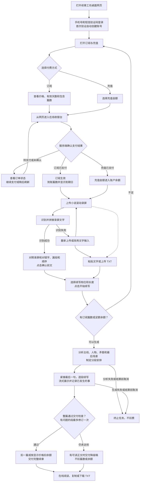

# 续章工坊 · 从登录、支付到交付续章

整个流程在桌面浏览器操作。用户可以购买有期限和篇数的订阅，也可以充值账户余额，按篇付费。订阅价格、有效天数、包含篇数、可选充值金额和单篇续写价格均由后台设置。

## 流程图

## 1. 注册与登录

在电脑浏览器打开[续章工坊](http://127.0.0.1:4173/)，点击「登录」。输入手机号，点「发送验证码」，再填写 6 位短信验证码。首次验证成功会自动建账号。之后用同一个手机号登录即可查看自己的余额、订阅和订单。

## 2. 购买订阅或充值

打开「订阅与充值」，根据需要选择一种方式：

| 方式 | 下单前看到什么 | 支付确认后的结果 |
| --- | --- | --- |
| 购买订阅 | 商品名称、售价、有效天数、包含篇数 | 获得该订阅的篇数和到期日 |
| 充值余额 | 可选充值金额和到账金额 | 实付金额等额进入账户余额。可以独立使用余额续写 |

点击「购买订阅」或「充值」进入在线收银台。完成付款后回到网页，等待服务端确认支付结果。看到「订阅已生效」或「充值已到账」后，可在「订单记录」确认状态为「已入账」。等待期间可以刷新支付状态，尚未完成付款的订单也可以继续支付。

订阅是一次性购买。有效期从支付入账起计算，到期后用户可以自行续购。已有篇数和余额可以同时存在。

## 3. 上传录屏并确认前文

1. 点击「选择录屏」，上传包含小说正文的滚动视频。支持 MP4、MOV、M4V，单个视频最长 3 分钟、最大 100 MB。让相邻画面保留几行相同文字，有助于拼接。
2. 等待识别。系统会按时间抽帧、识别文字、删除重叠行，并提示可能的漏段。
3. 打开「对照原录屏」，修正错字、漏段和段落顺序，尤其检查最后一句。确认前文后才能开始续写。正文可输入 1–8,000 个非空白字符。
4. 无法录屏时，点击「粘贴文本」或「上传 TXT」，继续走同一套分析和生成流程。

识别、核对和修改前文期间不消耗篇数或余额。

## 4. 分析、续写和结算

1. 先选续写档位，再选择短、中或长，目标约 4,000、6,000、8,000 字，受当前模型输出上限限制。点击「开始续写」。用余额消费时，按钮会显示该篇价格。
2. 网页先展示「前文分析」，包括主线剧情、主要人物、当前矛盾或待解事项、录屏最后停住的场景和分段安排。分析使用用户确认后的文字。
3. 系统从最后一句接着写，正文实时显示。后续段落会带上已经写过的事件、人物变化和未解决的事。
4. 系统检查篇幅、正文格式、开头是否直接照抄上文和明显重复。某段不合格时最多修订该段一次。全篇达标后只结算一次。有订阅篇数时任一档位都扣 1 篇。使用余额时按所选档位在按钮上显示的价格扣款。

## 5. 查看和下载结果

| 结果 | 页面交付 | 权益变化 |
| --- | --- | --- |
| 整篇通过检查 | 完整续章，支持复制和下载 TXT | 扣一篇或扣相应余额 |
| 修订后仍未达标 | 有可读内容时保留降级稿并提示 | 不扣 |
| 分析失败、生成失败或结算前取消 | 页面提示失败或停止，可能保留已收到的片段 | 不扣 |

「下载 TXT」保存的是本次生成的续章正文。当前浏览器可以恢复前文草稿，续章可在当次页面复制或下载留存。

[功能文档](功能文档.md) · [项目说明书](项目说明书.md)
