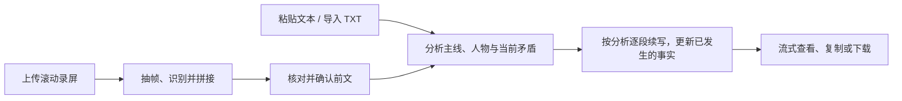

# 续章工坊 · 项目说明书

续章工坊是一个桌面网页工具。用户把小说正文的滚动录屏上传到网页，系统识别和拼接文字。用户确认前文后，可生成续章并下载。无法录屏时，可以粘贴文本或上传 TXT。当前版本面向桌面浏览器，手机端暂不开放。

| 入口 | 使用者 | 用途 |
| --- | --- | --- |
| [续章工坊](http://127.0.0.1:4173/) | 需要从小说录屏续写的用户 | 上传录屏、核对前文、续写与下载、登录、订阅和充值 |
| [管理后台](http://127.0.0.1:4173/admin) | 运营管理员 | 订阅与定价、支付订单、用户额度、服务端模型配置和用量 |

## 主流程

录屏识别独立于续写，不扣篇数或余额。识别服务按时间抽帧，使用 Apple Vision 识别屏幕文字，按画面位置组织文字行，再基于相邻画面的重叠去重。画面没有可靠重叠时提示用户检查漏段。点击「开始续写」后，服务端把前文原样交给模型，先分析主线、人物、当前矛盾、最后场景和分段任务，再逐段续写。主笔每段收到前文、结尾原句和已写各段的事实记录。字数、正文格式、照抄结尾与明显重复由代码检查，失败时只修订该段。分析与正文通过 SSE 返回。

用户可以在网页购买一次性限期订阅，或通过在线支付充值余额。订阅标明价格、有效天数和包含篇数。续写合格后优先扣一篇，篇数用完后按所选档位显示的价格扣余额。用户可以只充值按篇付费。支付通道目前接入 Stripe Checkout，由服务端确认支付和入账。

## 架构与数据

| 区域 | 说明 |
| --- | --- |
| 桌面网页与后台 | React、TypeScript、Vite。从 `/` 和 `/admin` 进入。前端处理文件选择、原录屏预览、核对编辑、流式显示和下载 |
| API | Node 原生 HTTP，处理录屏上传、短信登录、支付、生成和管理指令 |
| 视频识别 | macOS 上使用 AVFoundation 抽帧、Vision 识别。服务端使用临时视频文件，识别结束或请求取消后清理 |
| 文本生成 | 服务端支持 DeepSeek、Gemini 厂商级 Key，同一家可配置多个带独立售价的档位。服务端执行前文分析、分段、事实记录、流式生成、质检和结算。用户无需配置模型 Key |
| 浏览器数据 | IndexedDB 保存前文草稿及待核对状态。上传的录屏不会加入浏览器草稿库，生成的续章可复制或下载 |
| 服务端持久化 | SQLite 保存用户、权益、支付订单、模型档位、生成字数与用量。生成表没有完整视频、前文和正文字段 |

代码入口见 [网页](../src/reader/Reader.tsx)、[上传与清理](../server/ocr/upload.ts)、[抽帧与识别](../server/ocr/video.swift)、[拼接](../server/ocr/stitch.ts)、[故事分析与写作提示词](../server/story-context.ts)、[续写流程](../server/generate.ts)、[生成与结算 API](../server/api.ts)、[数据结构](../server/db.ts) 和 [后台](../server/admin.ts)。

## 运行与验收

运行 `npm ci`、`npm run build`、`npm start`。本机使用 macOS、Node.js 22.13+ 和 Xcode Command Line Tools 可构建识别程序。真实续写由服务端配置模型。短信登录和管理操作分别需要短信网关和管理员凭据。配置细节见 [README](../README.md)。

验收覆盖三类结果：

- 滚动录屏直接上传并执行实际 OCR。核对前文后通过模型桩验证流式续写。
- 短信登录、后台定价、订阅购买、余额充值、订单确认、篇数和余额结算。使用本地短信收件箱、模拟收银台、模型桩和临时 SQLite 验证。
- 类型、单测和生产构建。持续验证相邻画面拼接、重复行和断帧提示。

目前的 OCR 验收使用合成中文滚动样片。快速滚动、模糊、低对比度、多栏和弹窗遮挡都可能导致缺字、重复或漏段，实际平台录屏尚未覆盖。文本上传可作为备用入口。真实短信投递、模型内容质量、真实商户收款与退款属于独立验收事项。当前服务没有配置正式支付商户凭据。

界面与操作规则见 [功能文档](功能文档.md)，完整流程和流程图见 [用户全流程](用户全流程.md)。
